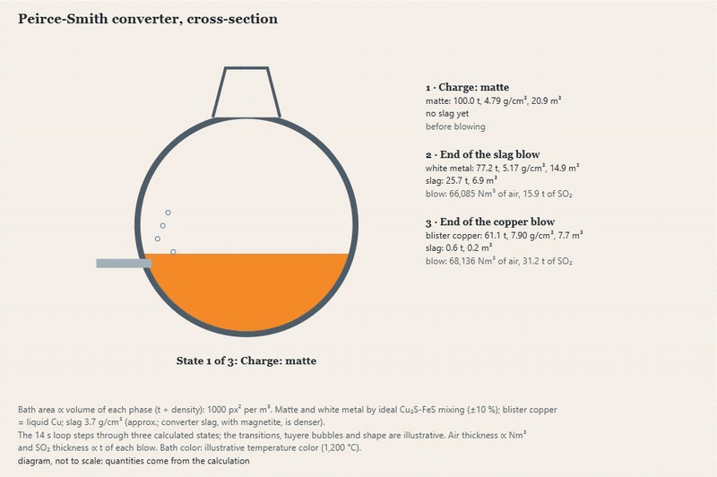

[Versión en español](README.md)

# simulador-procesos (process simulator)

A metallurgical process simulator implemented **from the literature**: mass and heat balance of plants with chemical reactions, aqueous equilibrium, recycles and control loops. It is independent of any commercial software.



**Phases 1 to 4 (this version):** steady-state mass and heat balance, aqueous chemical equilibrium with PHREEQC, solvent extraction and electrowinning of copper, grinding connected to simulador-conminucion, kinetic flotation, flash smelting and Peirce-Smith converting of copper (mass and heat balance), anode furnace, electrorefining with bleed and liberator cells, two-stage tin smelting, and an HTML report with flowsheet and operating cost.

```bash
pip install -e .
python -m procesos resolver ejemplos/lixiviacion_oxidos_cu.yaml --salida salidas
```

```
Planta: Lixiviación de óxidos de cobre
  Controlador "Acidez libre": 3,200.5820
  Convergió en 1 iteraciones · cortes: ninguno
  Balance por elemento (kg/h): ...
  Peor error de cierre: 1.15e-16
```

(The command-line output and the YAML plant files are in Spanish; the "Full plant" app below has an English version.)

## What it does

- **Species** with a chemical formula. The molar mass is calculated automatically and hydrates, ions and phases are supported.
- **Equipment:**
  - mixer;
  - splitter;
  - separator by species (flotation, thickener, filter);
  - reactor with stoichiometry and conversion of a key component. If another reactant runs out, the extent is limited by it and the program reports it.
- **Recycles:** the tear streams are chosen automatically and iterated with Wegstein.
- **Control loops:** "adjust X until Y reaches the target". One loop is solved with Brent and several together. If the target is unreachable, it is reported with numbers.
- **Guards:**
  - reactions that do not conserve atoms or charge are rejected when the plant is defined;
  - there are never negative flows;
  - the report shows the closure of the balance by element and by equipment.
- **Plant in readable YAML**, with errors that say where the problem is (see `ejemplos/`). The stream table comes out as CSV and Excel.

## Validation

3 cases compared with results calculated separately: a recycle with an exact solution, a leaching calculated by hand and a concentrator against the two-product formula. The detail is in [docs/casos-validacion.md](docs/casos-validacion.md) (in Spanish).

In addition, 3 real published plants: the production of Constancia (Hudbay), the leaching acid of Marimaca and the cathodes of the Puquios mining plan. The tolerances were fixed before running. Detail and findings in [docs/VALIDACION_PLANTAS_REALES.md](docs/VALIDACION_PLANTAS_REALES.md) (in Spanish).

517 tests (plus 50 expected failures: source rounding, the limits of the activity models, the electrolyte conductivity, the ideal-steam one, the JANAF-USGS discrepancy of FeO, what the flash furnace does not reach, the published converter charge that does not close, the refining voltage against the IsaKidd compendium and flotation from laboratory to pilot), 97 % coverage and clean ruff:

```bash
python -m pytest --cov=procesos
```

## Heat balance (phase 2)

With `balance_de_calor: true` in the YAML, each piece of equipment also closes the energy. The data are public: NIST-JANAF, USGS and CODATA.
- Mixers and adiabatic reactors calculate their outlet temperature.
- Reactors with fixed temperature and heaters give the heat needed.
- Control loops can fix an outlet temperature.

The species data were validated against independent sources: JANAF, IAPWS and USGS, with deviations of 0.6 % or less. The detail and the limits are in [docs/balance-de-calor.md](docs/balance-de-calor.md) (in Spanish).

```bash
python -m procesos resolver ejemplos/lixiviacion_con_calor.yaml
```

## Chemical equilibrium (phase 3)

The `equilibrio` equipment decides by equilibrium how much dissolves or precipitates, for example gypsum in a leaching solution, and gives the pH. It uses USGS PHREEQC (public domain) through phreeqpy, and it is optional: `pip install -e ".[equilibrio]"`.
- Validated against the solubility of gypsum in water (+4.5 %) and in sulfuric acid up to 0.4 mol/kg (±15 %).
- Above an ionic strength of 0.5 mol/kg, the activity model goes out of range, and it is documented.
- To crystallize chalcanthite in acid (up to 3 mol/kg) there is `base: cu_h2so4_fuentes.dat`, the model of Fuentes et al. (2023): it reproduces the measured solubility at −3.7 %.
- For concentrated solutions, `base: pitzer_cu.dat` uses the Pitzer model. It is the public USGS database plus a copper block at 25 °C taken from the literature.
  - Gypsum in H2SO4 up to 3 mol/kg falls between −1.9 % and −5.4 %, and chalcanthite in water at −2.3 %.
  - **It is not suitable for copper with free acid:** it overestimates the solubility of chalcanthite between 14 and 113 % against measured data, and the simulator warns.

See [docs/equilibrio.md](docs/equilibrio.md) (in Spanish).

```bash
python -m procesos resolver ejemplos/lixiviacion_equilibrio.yaml
```

## Copper solvent extraction

The `extraccion_solventes` and `despojo` equipment calculate, stage by stage and countercurrent, how much copper passes into the organic. They use the equilibrium Cu²⁺ + 2 RH ⇌ CuR₂ + 2 H⁺ of LIX 984N (Devi and Nayak 2014), with Murphree efficiency and the acid that is released. The organic can circulate in a closed circuit between extraction and stripping.
- **Validated extraction:** it reproduces Devi's single-contact and 2-stage countercurrent experiments with a deviation of 2.3 % or less. With the Isocalc organic it recovers 89.4 % against 92.8 %.
- **Stripping:** with concentrated acid the H⁺ activity is needed (`acidez: pitzer`, with PHREEQC). With it, the stripped organic and the electrolyte agree with Devi and with Isocalc, and the circuit recovers 90.1 % against 92.8 %. With ideal H⁺ it stays at 70 %, documented as an expected failure.

See [docs/sx.md](docs/sx.md) (in Spanish).

```bash
python -m procesos resolver ejemplos/sx_2e1s.yaml
```

## Copper electrowinning

The `electroobtencion` equipment deposits the copper by Faraday's law with the current efficiency and calculates the cell voltage by components: reversible potential, anodic and cathodic overpotentials (Beukes and Badenhorst 2009), drop in the electrolyte with the conductivity of Kalliomäki et al. (2021) and contacts. The electricity enters the operating cost and, with heat balance, the energy balance.
- With a typical electrolyte at 300 A/m² it gives 2.18 V and 1,998 kWh/t, within industry ranges (1.9-2.3 V; 1,800-2,200 kWh/t). The design output of Gunnison (NI 43-101) is consistent with its current.
- **Finding:** the conductivity correlation overestimates by 9-12 % what was measured in a laboratory electrolyte (Fuentes 2022). In the cell, that is ~0.03 V. It is documented as an expected failure.
- `ejemplos/sx_ew_circuito.yaml` closes the SX-EW circuit: the electrolyte circulates between stripping and tankhouse, with bleed and make-up, and a control loop sets the current. It produces 1,839 kg/h of cathodes at 1,969 kWh/t.

See [docs/ew.md](docs/ew.md) (in Spanish).

```bash
python -m procesos resolver ejemplos/sx_ew_circuito.yaml
```

## Kinetic flotation

The `flotacion` equipment replaces the fixed recovery with first-order kinetics per species (a single constant or Klimpel's rectangular distribution) in a bank of cells in series. `python -m procesos ajustar` fits the kinetics to a batch test or to the profile of a bank.
- Validated with the industrial rougher banks of Los Pelambres (Vinnett et al. 2022, open access). With their parameters it reproduces their modeled recoveries to 0.4 points or less. Fitting their measured recoveries it obtains their parameters: R∞ to 0.1 points and k to 1.3 % or less.
- **From laboratory to pilot** (Minerals 16(7):726, 2026, with two-component Kelsall kinetics): it predicts the Cu grade of the concentrate (+4 %), but not the pyrite or the gangue. 5 of 9 comparisons fall outside and it does not pass the threshold. The authors' own simulation cannot be reproduced with what was published. The scale-up factor is calibrated with the plant (Vallejos 2023: from 0.8 to 15.7).

See [docs/flotacion.md](docs/flotacion.md) (in Spanish).

## Grinding connected to simulador-conminucion

The `molienda` equipment calls the sister project [simulador-conminucion](https://github.com/Laxionx/simulador-conminucion) (optional extra: `pip install -e ".[molienda]"`). It does not change the composition: it delivers the P80, the circulating load and the power, which enters the cost as electricity.
- Bond mode (Wi, F80, P80) or circuit mode (mill and cyclone simulated with the Bougainville template, validated against MODSIM).
- What is connected is identical to running conminucion separately, and it keeps its validations: Bougainville against MODSIM (circulating load 81.87 % versus 81.92 %) and Constancia (14 Bond samplings within ±5 %).
- `ejemplos/concentradora_con_molienda.yaml`: grinding + rougher-cleaner flotation; 100 t/h, P80 221 µm, 1,087 kW.

See [docs/molienda.md](docs/molienda.md) (in Spanish).

## Copper flash smelting (pyrometallurgy, phase 4a)

`procesos.fusion.smelt` does the mass and heat balance of the flash furnace per tonne of charge. It starts from the mineralogy of the blend, the matte grade, the silica of the slag and the heat loss of the furnace. It returns the oxygen, the enrichment with which it smelts without fuel and the flux.
- Enthalpies of formation from USGS B2131 and sensible heat from NIST-JANAF and the US Bureau of Mines (RI 8305). It reproduces the heat content of Cu2S-FeS mattes measured at 1,473 K with −0.8 to −1.6 % error.
- Against the operation of Atlantic Copper in four blends (Bacedoni et al. 2020, open access), 7 of 12 comparisons fall within tolerance. It passes the threshold narrowly:
  - the oxygen comes out 7 to 14 % low, as in the paper's own model;
  - the flux comes out low;
  - in blend 3 it does not reach the measured enrichment. The published mineralogy of that blend carries 1 point more sulfur than its assay.
- It is a calculation module, not a YAML equipment. `python ejemplos/fusion_atlantic_copper.py` runs the validation.

See [docs/fusion.md](docs/fusion.md) (in Spanish).

## Peirce-Smith converting and anode furnace (phase 4b)

`procesos.conversion` does the mass and heat balance of the converter by stage (slag blow and copper blow). It gives the air, the slag, the white metal, the blister copper, the SO2 and the cold charge that the surplus heat manages to melt. `procesos.anodos` does the oxidation and reduction of the blister; it is not validated against a plant because there are no open measured data.
- Against plant charges published in open theses (Rönnskär, Lennartsson 2013; Flin Flon, Kyllo 1995), 4 of 7 comparisons fall within tolerance. It passes the threshold narrowly:
  - Flin Flon, with complete analyses, gives the slag at −13 to +10 %;
  - at Rönnskär, the published charge does not close either in copper (−13 %) or in heat, and the matte comes without its Fe or its S;
  - the thesis's own model (FactSage) gives the same numbers as this one.
- Calculation module, not a YAML equipment. `python ejemplos/conversion_ilo.py` takes 100 t of matte with Ilo parameters through to anode (illustrative).

See [docs/conversion.md](docs/conversion.md) (in Spanish).

## Electrorefining (phase 4c)

The `electrorrefinacion` equipment receives anodes and electrolyte and gives cathodes (Faraday), slimes, scrap, cell voltage and energy. It also calculates what accumulates in the electrolyte: Ni displaces Cu without consuming acid, and the Cu2O of the anode adds Cu and consumes acid. With that it sizes the Ni bleed and the liberator cells, which use the electrowinning equipment.
- The conductivity comes from the κER.2 model (Kalliomäki et al. 2021, with Ni and As). Against independent measurements (Fuentes, USM 2022), 5 of 8 fall within and it passes the threshold. With M3 it overestimates 7 to 13 %, like the electrowinning model with that same sample.
- Mount Isa (IsaKidd compendium): Faraday with its geometry gives 93.5 % availability, consistent with its capacity.
- The voltage is not validated: j·L/κ gives a third less drop in the electrolyte than the typical refinery of the compendium.
- The distribution of impurities is not validated against a plant.
- `ejemplos/refineria_atlantic_mount_isa.yaml`: Atlantic Copper anodes with the Mount Isa geometry, plus liberators and bleed (illustrative).

See [docs/er.md](docs/er.md) (in Spanish).

## Two-stage tin smelting (phase 4d)

`procesos.estano.smelt_tin` does the mass balance of a tin smelter like Funsur's. There are two stages: the smelting of the concentrate gives crude tin and a rich slag, and the reduction of the slag gives hardhead and discard slag. The hardhead and the fumes are recycled. The Sn/Fe split follows the distribution coefficient D of the reaction SnO + Fe = Sn + FeO.
- The literature's D values (150-400 in smelting and 20-50 in reduction, Kandalam et al. 2023) hold up against 81 measured equilibria (Takeda et al. 1990): medians of 166 and 35, but with a lot of scatter, and D rises with basicity.
- Funsur 2022-2025 (Minsur's Memoria Integrada 2025): the recovery calculated with the Sn that enters and the refined one falls 0.6-0.7 points below the reported one, all four years. With the assumed gangue, the discard slag at 0.55 % explains only a quarter of the loss.
- Heat balance with natural gas per stage (`procesos.estano_calor`): 2.34 GJ per t of concentrate without furnace losses. It gives 46,960 t of CO2, below the 85,087 t direct from Pisco in 2025, which are an upper bound of the losses.
- `python ejemplos/estano_funsur.py` runs the Funsur 2025 case (illustrative: the gangue of the concentrate is not published).

See [docs/estano.md](docs/estano.md) (in Spanish).

## Concentrate-to-cathode chain

`procesos.cadena.concentrate_to_cathode` takes a tonne of concentrate through flash smelting, the converter, the anode furnace and refining. Cu and S close from end to end (1e-15).
- With Atlantic Copper's blend 1, 95.8 % of the Cu reaches the cathodes, without recirculating slags. It gives 0.875 t of potential acid per t of concentrate, consistent with the 0.94-1.00 of the Ilo smelter (10-K 2025).
- `python ejemplos/cadena_atlantic.py`.

See [docs/cadena.md](docs/cadena.md) (in Spanish).

## Full plant app

A didactic Streamlit app: metallurgical equipment animated from its real calculation (flotation in series, flash furnace, Peirce-Smith converter and electrowinning cell), with a guide to the path from the concentrate to the cathode. The bubbles, the froth, the layers of the bath and the copper deposit are drawn with the numbers of `procesos.flotacion`, `procesos.fusion`, `procesos.conversion` and `procesos.ew`.

**[▶ Try it in the browser](https://simulador-procesos-ntfmuyhlnqc9d73kkqljzk.streamlit.app/?lang=en)** (Streamlit Community Cloud, no sign-up). The app has an Español / English selector at the top of the sidebar; `?lang=en` opens it in English.

```bash
pip install -e ".[app]"
streamlit run app/streamlit_app.py
```

For the cloud, `requirements.txt` is enough (pinned versions). The input data and the "What data it needs" table come from a single definition, `app/controles.py`; the texts of each language are in `app/textos_es*.py` and `app/textos_en*.py`.

## HTML report and operating cost (phase 4)

```bash
python -m procesos resolver ejemplos/lixiviacion_con_calor.yaml --html salidas/lixiviacion.html
```

It generates a single HTML file, with no JavaScript or external resources. It brings the flowsheet with the recycles marked, the streams, the balances, the equilibrium and the operating cost per hour and per tonne. The cost uses the prices that are put in the `costos:` section of the YAML. The capital cost is not estimated.


See [docs/reporte-y-costos.md](docs/reporte-y-costos.md) (in Spanish).

## Roadmap

| Phase | Content |
|---|---|
| 1 ✅ | Mass balance with reactions, recycles and control loops |
| 2 ✅ | Heat balance: enthalpies and temperatures with public data (NIST-JANAF, USGS, CODATA) |
| 3 ✅ | Aqueous chemical equilibrium with PHREEQC: minteq.v4 up to an ionic strength of ~0.5 mol/kg; Pitzer for concentrated solutions without acidic copper |
| 4 ✅ | HTML report with flowsheet and operating cost; no capital cost (there are no validated public correlations) |
| 4a ✅ | Pyrometallurgy: copper flash smelting, mass and heat balance (public data USGS, JANAF, USBM) |
| 4b ✅ | Peirce-Smith converting and anode furnace (the latter not validated against a plant) |
| 4c ✅ | Electrorefining with Ni bleed and liberator cells; conductivity validated, voltage and impurity distribution not |
| 4d ✅ | Two-stage tin smelting: mass balance with literature D, contrasted with measured equilibria and consistent with Funsur |

## Limits of this version

- Without `balance_de_calor`, the temperature is carried along without balancing: the mixer averages it by mass.
- The heat balance already includes the heat of dilution of H2SO4 (Wu and Young 1980; NBS 1982) and the evaporation of water (IAPWS-IF97). Steam is treated as ideal, so at several bar the error exceeds 1.8 %, and the boiling-point rise is not modeled (see [docs/balance-de-calor.md](docs/balance-de-calor.md), in Spanish).
- The pressure is carried but not balanced.
- The separators use fixed recoveries; for flotation there is a kinetic model (see above). Grinding is connected with the sister project `simulador-conminucion` (see above); the size distribution does not travel to the following equipment.

## License

MIT · Anthony Vera Baldeón
