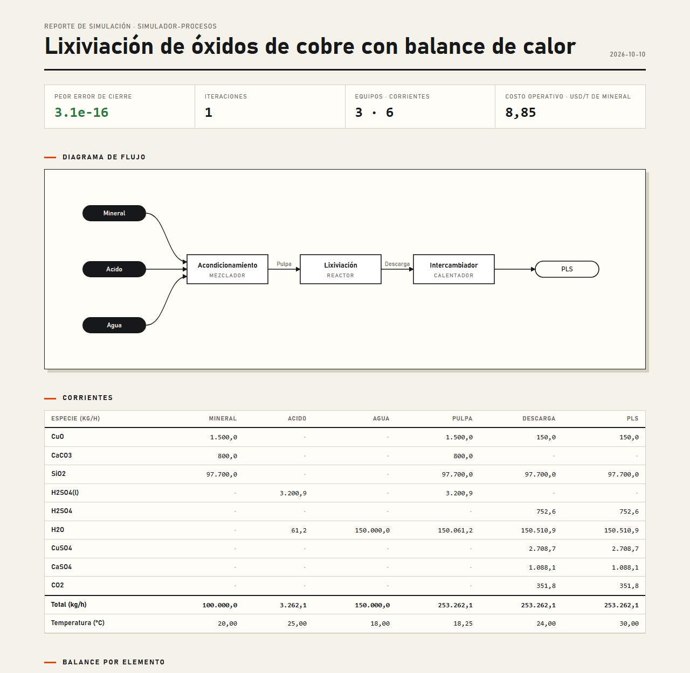

# simulador-procesos

Simulador de procesos metalúrgicos implementado **desde la literatura**: balance de masa y de calor de plantas con reacciones químicas, equilibrio acuoso, reciclos y lazos de control. Es independiente de cualquier software comercial.

**Fases 1 a 4 (esta versión):** balance de masa y de calor en estado estacionario, equilibrio químico acuoso con PHREEQC, extracción por solventes y electroobtención de cobre, molienda conectada a simulador-conminucion, flotación cinética, fusión flash y conversión Peirce-Smith de cobre (balance de masa y de calor), horno de ánodos, electrorrefinación con purga y celdas liberadoras, fundición de estaño en dos etapas, y reporte HTML con diagrama de flujo y costo operativo.

```bash
pip install -e .
python -m procesos resolver ejemplos/lixiviacion_oxidos_cu.yaml --salida salidas
```

```
Planta: Lixiviación de óxidos de cobre
  Controlador «Acidez libre»: 3,200.5820
  Convergió en 1 iteraciones · cortes: ninguno
  Balance por elemento (kg/h): ...
  Peor error de cierre: 1.15e-16
```

## Qué hace

- **Especies** con fórmula química. La masa molar se calcula sola y se admiten hidratos, iones y fases.
- **Equipos:**
  - mezclador;
  - divisor;
  - separador por especie (flotación, espesador, filtro);
  - reactor con estequiometría y conversión de un componente clave. Si otro reactivo se agota, el avance se limita a él y lo informa.
- **Reciclos:** las corrientes de corte se eligen solas y se iteran con Wegstein.
- **Lazos de control:** «ajusta X hasta que Y llegue a la meta». Un lazo se resuelve con Brent y varios en conjunto. Si la meta es inalcanzable, se informa con números.
- **Guardas:**
  - las reacciones que no conservan átomos o carga se rechazan al definir la planta;
  - nunca hay flujos negativos;
  - el reporte muestra el cierre del balance por elemento y por equipo.
- **Planta en YAML** legible, con errores que indican dónde está el problema (ver `ejemplos/`). La tabla de corrientes sale en CSV y Excel.

## Validación

3 casos comparados con resultados calculados aparte: un reciclo con solución exacta, una lixiviación calculada a mano y una concentradora contra la fórmula de dos productos. El detalle está en [docs/casos-validacion.md](docs/casos-validacion.md).

Además, 3 plantas reales publicadas: la producción de Constancia (Hudbay), el ácido de lixiviación de Marimaca y los cátodos del plan minero de Puquios. Las tolerancias se fijaron antes de correr. Detalle y hallazgos en [docs/VALIDACION_PLANTAS_REALES.md](docs/VALIDACION_PLANTAS_REALES.md).

467 pruebas (más 41 fallos esperados: redondeos de la fuente, los límites de los modelos de actividad, la conductividad del electrolito, el del vapor ideal, la discrepancia JANAF-USGS del FeO, lo que el horno flash no alcanza, la carga de convertidor publicada que no cierra y el voltaje de refinación frente al compendio IsaKidd), cobertura del 97 % y ruff limpio:

```bash
python -m pytest --cov=procesos
```

## Balance de calor (fase 2)

Con `balance_de_calor: true` en el YAML, cada equipo cierra también la energía. Los datos son públicos: NIST-JANAF, USGS y CODATA.
- Los mezcladores y los reactores adiabáticos calculan su temperatura de salida.
- Los reactores con temperatura fija y los calentadores dan el calor necesario.
- Los lazos de control pueden fijar una temperatura de salida.

Los datos de las especies se validaron contra fuentes independientes: JANAF, IAPWS y USGS, con desvíos de 0,6 % o menos. El detalle y los límites están en [docs/balance-de-calor.md](docs/balance-de-calor.md).

```bash
python -m procesos resolver ejemplos/lixiviacion_con_calor.yaml
```

## Equilibrio químico (fase 3)

El equipo `equilibrio` decide por equilibrio cuánto se disuelve o precipita, por ejemplo el yeso en una solución de lixiviación, y da el pH. Usa PHREEQC del USGS (dominio público) mediante phreeqpy, y es opcional: `pip install -e ".[equilibrio]"`.
- Validado contra la solubilidad del yeso en agua (+4,5 %) y en ácido sulfúrico hasta 0,4 mol/kg (±15 %).
- Sobre una fuerza iónica de 0,5 mol/kg, el modelo de actividad se sale de rango, y está documentado.
- Para cristalizar calcantita en ácido (hasta 3 mol/kg) está `base: cu_h2so4_fuentes.dat`, el modelo de Fuentes et al. (2023): reproduce la solubilidad medida a −3,7 %.
- Para soluciones concentradas, `base: pitzer_cu.dat` usa el modelo de Pitzer. Es la base pública del USGS más un bloque de cobre a 25 °C tomado de la literatura.
  - El yeso en H2SO4 hasta 3 mol/kg queda entre −1,9 % y −5,4 %, y la calcantita en agua en −2,3 %.
  - **No sirve para cobre con ácido libre:** sobreestima la solubilidad de la calcantita entre 14 y 113 % contra datos medidos, y el simulador avisa.

Ver [docs/equilibrio.md](docs/equilibrio.md).

```bash
python -m procesos resolver ejemplos/lixiviacion_equilibrio.yaml
```

## Extracción por solventes de cobre

Los equipos `extraccion_solventes` y `despojo` calculan, etapa por etapa y en contracorriente, cuánto cobre pasa al orgánico. Usan el equilibrio Cu²⁺ + 2 RH ⇌ CuR₂ + 2 H⁺ del LIX 984N (Devi y Nayak 2014), con eficiencia de Murphree y el ácido que se libera. El orgánico puede circular en circuito cerrado entre la extracción y el despojo.
- **Extracción validada:** reproduce los experimentos de un contacto y de 2 etapas a contracorriente de Devi con un desvío de 2,3 % o menos. Con el orgánico de Isocalc recupera 89,4 % contra 92,8 %.
- **Despojo:** con ácido concentrado hace falta la actividad del H⁺ (`acidez: pitzer`, con PHREEQC). Con ella, el orgánico despojado y el electrolito cuadran con Devi y con Isocalc, y el circuito recupera 90,1 % contra 92,8 %. Con el H⁺ ideal se queda en 70 %, documentado como fallo esperado.

Ver [docs/sx.md](docs/sx.md).

```bash
python -m procesos resolver ejemplos/sx_2e1s.yaml
```

## Electroobtención de cobre

El equipo `electroobtencion` deposita el cobre por la ley de Faraday con la eficiencia de corriente y calcula el voltaje de celda por componentes: potencial reversible, sobrepotenciales anódico y catódico (Beukes y Badenhorst 2009), caída en el electrolito con la conductividad de Kalliomäki et al. (2021) y contactos. La electricidad entra al costo operativo y, con balance de calor, al balance de energía.
- Con un electrolito típico a 300 A/m² da 2,18 V y 1.998 kWh/t, dentro de los rangos de la industria (1,9-2,3 V; 1.800-2.200 kWh/t). La producción de diseño de Gunnison (NI 43-101) es coherente con su corriente.
- **Hallazgo:** la correlación de conductividad sobrestima en 9-12 % la medida en un electrolito de laboratorio (Fuentes 2022). En la celda, eso son ~0,03 V. Está documentado como fallo esperado.
- `ejemplos/sx_ew_circuito.yaml` cierra el circuito SX-EW: el electrolito circula entre despojo y nave, con purga y reposición, y un lazo de control fija la corriente. Saca 1.839 kg/h de cátodos a 1.969 kWh/t.

Ver [docs/ew.md](docs/ew.md).

```bash
python -m procesos resolver ejemplos/sx_ew_circuito.yaml
```

## Flotación cinética

El equipo `flotacion` reemplaza la recuperación fija por cinética de primer orden por especie (constante única o distribución rectangular de Klimpel) en un banco de celdas en serie. `python -m procesos ajustar` ajusta la cinética a una prueba batch o al perfil de un banco.
- Validado con los bancos rougher industriales de Los Pelambres (Vinnett et al. 2022, acceso abierto). Con sus parámetros reproduce sus recuperaciones modeladas a 0,4 puntos o menos. Ajustando sus recuperaciones medidas obtiene sus parámetros: R∞ a 0,1 puntos y k a 1,3 % o menos.
- **No validado:** la predicción de laboratorio a planta. En cuatro plantas chilenas, el factor de escalamiento fue de 0,8 a 15,7 (Vallejos 2023), así que se calibra con la planta.

Ver [docs/flotacion.md](docs/flotacion.md).

## Molienda conectada a simulador-conminucion

El equipo `molienda` llama al proyecto hermano [simulador-conminucion](https://github.com/Laxionx/simulador-conminucion) (extra opcional: `pip install -e ".[molienda]"`). No cambia la composición: entrega el P80, la carga circulante y la potencia, que entra al costo como electricidad.
- Modo Bond (Wi, F80, P80) o modo circuito (molino y ciclón simulados con la plantilla Bougainville, validada contra MODSIM).
- Lo conectado es idéntico a correr conminucion por separado, y conserva sus validaciones: Bougainville contra MODSIM (carga circulante 81,87 % frente a 81,92 %) y Constancia (14 muestreos de Bond a ±5 %).
- `ejemplos/concentradora_con_molienda.yaml`: molienda + flotación rougher-cleaner; 100 t/h, P80 221 µm, 1.087 kW.

Ver [docs/molienda.md](docs/molienda.md).

## Fusión flash de cobre (pirometalurgia, fase 4a)

`procesos.fusion.smelt` hace el balance de masa y de calor del horno flash por tonelada de carga. Parte de la mineralogía de la mezcla, la ley de mata, la sílice de la escoria y la pérdida térmica del horno. Devuelve el oxígeno, el enriquecimiento con que funde sin combustible y el fundente.
- Entalpías de formación de USGS B2131 y calor sensible de NIST-JANAF y del US Bureau of Mines (RI 8305). Reproduce el contenido calórico de matas Cu2S-FeS medido a 1.473 K con −0,8 a −1,6 % de error.
- Contra la operación de Atlantic Copper en cuatro mezclas (Bacedoni et al. 2020, acceso abierto), 7 de 12 comparaciones quedan dentro de tolerancia. Pasa el corte por poco:
  - el oxígeno queda 7 a 14 % bajo, como en el modelo del propio artículo;
  - el fundente queda bajo;
  - en la mezcla 3 no alcanza el enriquecimiento medido. La mineralogía publicada de esa mezcla trae 1 punto más de azufre que su ensaye.
- Es un módulo de cálculo, no un equipo del YAML. `python ejemplos/fusion_atlantic_copper.py` corre la validación.

Ver [docs/fusion.md](docs/fusion.md).

## Conversión Peirce-Smith y horno de ánodos (fase 4b)

`procesos.conversion` hace el balance de masa y de calor del convertidor por etapa (soplado a escoria y a cobre). Da el aire, la escoria, el metal blanco, el blíster, el SO2 y la carga fría que alcanza a fundir el calor sobrante. `procesos.anodos` hace la oxidación y la reducción del blíster; no está validado contra planta porque no hay datos medidos abiertos.
- Contra cargas de planta publicadas en tesis abiertas (Rönnskär, Lennartsson 2013; Flin Flon, Kyllo 1995), 4 de 7 comparaciones quedan dentro de tolerancia. Pasa el corte por poco:
  - Flin Flon, con análisis completos, da la escoria a −13 a +10 %;
  - en Rönnskär, la carga publicada no cierra ni en cobre (−13 %) ni en calor, y la mata viene sin su Fe ni su S;
  - el modelo de la propia tesis (FactSage) da los mismos números que este.
- Módulo de cálculo, no equipo del YAML. `python ejemplos/conversion_ilo.py` lleva 100 t de mata con parámetros de Ilo hasta ánodo (ilustrativo).

Ver [docs/conversion.md](docs/conversion.md).

## Electrorrefinación (fase 4c)

El equipo `electrorrefinacion` recibe ánodos y electrolito y da cátodos (Faraday), barro, chatarra, voltaje de celda y energía. También calcula lo que se acumula en el electrolito: el Ni desplaza Cu sin gastar ácido, y el Cu2O del ánodo suma Cu y consume ácido. Con eso dimensiona la purga de Ni y las celdas liberadoras, que usan el equipo de electroobtención.
- La conductividad viene del modelo κER.2 (Kalliomäki et al. 2021, con Ni y As). Contra mediciones independientes (Fuentes, USM 2022), quedan dentro 5 de 8 y pasa el corte. Con M3 sobrestima 7 a 13 %, como el modelo de electroobtención con esa misma muestra.
- Mount Isa (compendio IsaKidd): Faraday con su geometría da 93,5 % de disponibilidad, coherente con su capacidad.
- El voltaje no está validado: j·L/κ da un tercio menos de caída en el electrolito que la refinería típica del compendio.
- El reparto de impurezas no está validado contra planta.
- `ejemplos/refineria_atlantic_mount_isa.yaml`: ánodos de Atlantic Copper con la geometría de Mount Isa, más liberadoras y purga (ilustrativo).

Ver [docs/er.md](docs/er.md).

## Fundición de estaño en dos etapas (fase 4d)

`procesos.estano.smelt_tin` hace el balance de masa de una fundición de estaño como la de Funsur. Hay dos etapas: la fusión del concentrado da estaño crudo y una escoria rica, y la reducción de la escoria da hardhead y escoria de desecho. El hardhead y los humos se reciclan. El reparto Sn/Fe sigue el coeficiente de distribución D de la reacción SnO + Fe = Sn + FeO.
- Los D de la literatura (150-400 en la fusión y 20-50 en la reducción, Kandalam et al. 2023) se sostienen frente a 81 equilibrios medidos (Takeda et al. 1990): medianas de 166 y 35, pero con mucha dispersión, y D sube con la basicidad.
- Funsur 2022-2025 (Memoria Integrada 2025 de Minsur): la recuperación calculada con el Sn que entra y el refinado queda 0,6-0,7 puntos bajo la reportada, los cuatro años. Con la ganga supuesta, la escoria de desecho al 0,55 % explica solo una cuarta parte de la pérdida.
- Balance de masa sin calor. `python ejemplos/estano_funsur.py` corre el caso Funsur 2025 (ilustrativo: la ganga del concentrado no se publica).

Ver [docs/estano.md](docs/estano.md).

## Reporte HTML y costo operativo (fase 4)

```bash
python -m procesos resolver ejemplos/lixiviacion_con_calor.yaml --html salidas/lixiviacion.html
```

Genera un solo archivo HTML, sin JavaScript ni recursos externos. Trae el diagrama de flujo con los reciclos marcados, las corrientes, los balances, el equilibrio y el costo operativo por hora y por tonelada. El costo usa los precios que se ponen en la sección `costos:` del YAML. El costo de capital no se estima.



Ver [docs/reporte-y-costos.md](docs/reporte-y-costos.md).

## Hoja de ruta

| Fase | Contenido |
|---|---|
| 1 ✅ | Balance de masa con reacciones, reciclos y lazos de control |
| 2 ✅ | Balance de calor: entalpías y temperaturas con datos públicos (NIST-JANAF, USGS, CODATA) |
| 3 ✅ | Equilibrio químico acuoso con PHREEQC: minteq.v4 hasta una fuerza iónica de ~0,5 mol/kg; Pitzer para soluciones concentradas sin cobre ácido |
| 4 ✅ | Reporte HTML con diagrama de flujo y costo operativo; sin costo de capital (no hay correlaciones públicas validadas) |
| 4a ✅ | Pirometalurgia: fusión flash de cobre, balance de masa y de calor (datos públicos USGS, JANAF, USBM) |
| 4b ✅ | Conversión Peirce-Smith y horno de ánodos (este último sin validar contra planta) |
| 4c ✅ | Electrorrefinación con purga de Ni y celdas liberadoras; conductividad validada, voltaje y reparto de impurezas no |
| 4d ✅ | Fundición de estaño en dos etapas: balance de masa con D de literatura, contrastado con equilibrios medidos y coherente con Funsur |

## Límites de esta versión

- Sin `balance_de_calor`, la temperatura se transporta sin balancear: el mezclador la promedia por masa.
- El balance de calor ya incluye el calor de dilución del H2SO4 (Wu y Young 1980; NBS 1982) y la evaporación del agua (IAPWS-IF97). El vapor se trata como ideal, así que a varios bar el error pasa del 1,8 %, y no se modela la subida del punto de ebullición (ver [docs/balance-de-calor.md](docs/balance-de-calor.md)).
- La presión se transporta pero no se balancea.
- Los separadores usan recuperaciones fijas; para flotación hay un modelo cinético (ver arriba). La molienda se conecta con el proyecto hermano `simulador-conminucion` (ver arriba); la granulometría no viaja a los equipos siguientes.

## Licencia

MIT · Anthony Vera Baldeón
